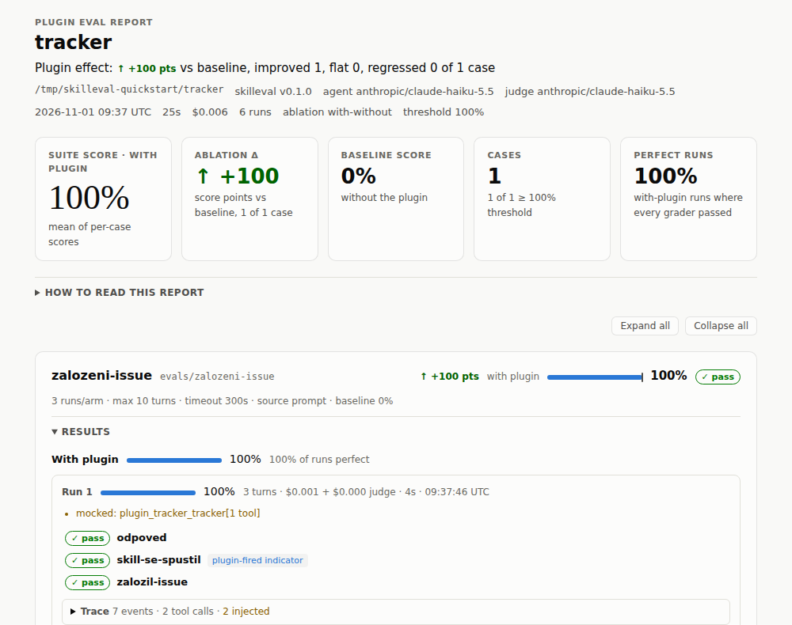

<div align="center">

# skilleval

**Automatické testy pro skilly AI agentů.**<br>
Změřte, jestli skill agentovi opravdu pomáhá. Na libovolném modelu a bez Claude Code.


[Rychlý start](#rychlý-start) • [Psaní evalů](#psaní-evalů) • [Mocky a chyby](#mocky-a-reálné-servery) • [CI](#použití-v-ci) • [Omezení](#kompatibilita-s-claude-code-a-omezení)

</div>

Skill se od oka testuje špatně. Agent je nedeterministický, odpověď může znít rozumně, i když nezavolal správný tool, a model by možná totéž zvládl i bez skillu.

skilleval spustí každý scénář opakovaně **se skillem a bez něj**, výsledky ohodnotí a vrátí jedno číslo: **Δ, tedy kolik bodů skill skutečně přidal.** Čte sady ve formátu [Claude Code plugin evals](https://code.claude.com/docs/en/plugin-evals), ale agenta spouští vlastním harnessem v LangGraphu přes OpenRouter.

```text
CASE            WITH  W/OUT Δ      RUNS COST    NOTES
zalozeni-issue  1.00  0.00  +1.00  6    $0.01
```

<p align="center"></p>

## Co umí

- **Měří přínos, ne jen úspěšnost:** with/without běhy odhalí skill, který nic nepřidává.
- **Libovolný model:** agent i soudce se volí zvlášť. Stačí alias (`haiku`) nebo slug z OpenRouteru (`openai/gpt-oss-120b`).
- **Šest typů graderů:** od regexu a pořadí volání toolů po hlasujícího LLM soudce a porovnání s referenčním transcriptem.
- **Mocky MCP serverů:** statické odpovědi, kontrola vstupů i server „hraný“ modelem. Bez běžícího backendu a bez rizika zápisu.
- **Fault injection nad reálným serverem:** `conflict` na N-té volání, profil uživatele s nižšími právy, simulovaný uživatel, setup a teardown.
- **Hlídání nákladů a regresí:** strop `--max-cost-usd`, přesná cena z OpenRouteru a `skilleval compare` mezi dvěma běhy.
- **Čitelné výstupy:** soběstačný `report.html` s prohlížečem trace, JSON se schématem jako v Claude Code a trace ve formátu `stream-json`.
- **Víc pluginů v jednom běhu:** pro skilly, které se navzájem odkazují.

## Rychlý start

Potřebujete Python 3.13+, [Poetry](https://python-poetry.org/) a [API klíč OpenRouteru](https://openrouter.ai/keys).

```bash
git clone <URL-repozitáře> skill-eval && cd skill-eval
poetry install
source .venv/bin/activate
export OPENROUTER_API_KEY=sk-or-…
```

> [!TIP]
> Pokud Poetry nainstaluje závislosti do jiného aktivního virtualenvu, použijte `env -u VIRTUAL_ENV poetry install`.

### 1. Vytvořte plugin se skillem

```text
tracker/
├── plugin.json
├── .mcp.json
├── skills/tracker-help/SKILL.md
└── evals/
    ├── mocks/tracker/
    │   ├── _tools.json
    │   └── create_issue.md
    └── zalozeni-issue/
        ├── prompt.md
        └── graders/
            ├── zalozil-issue.md
            ├── odpoved.md
            └── skill-se-spustil.md
```

`plugin.json` pojmenuje plugin a `.mcp.json` deklaruje jeho MCP server. Ten se díky mocku vůbec nespustí:

```json
{ "name": "tracker" }
```

```json
{ "mcpServers": { "tracker": { "type": "http", "url": "https://tracker.example.com/mcp" } } }
```

`skills/tracker-help/SKILL.md` je testovaný skill:

```markdown
---
name: tracker-help
description: Správa issues v trackeru. Použij, když uživatel chce založit nebo najít issue.
---

Issue zakládej toolem create_issue. V odpovědi vždy uveď číslo založeného issue.
```

### 2. Nahraďte server mockem

`evals/mocks/tracker/create_issue.md` určuje odpověď toolu a kontroluje jeho vstup:

```markdown
---
expect:
  title: string
---

Created issue #4821: {{input.title}}
```

`evals/mocks/tracker/_tools.json` dodá modelu skutečné schéma toolu:

```json
{
  "tools": [{
    "name": "create_issue",
    "description": "Založí issue v trackeru.",
    "inputSchema": {
      "type": "object",
      "properties": { "title": { "type": "string" } },
      "required": ["title"]
    }
  }]
}
```

> [!IMPORTANT]
> Bez `_tools.json` dostane model volné schéma bez parametrů. Výsledek pak závisí na tom, jestli argumenty uhodne: v našem příkladu Haiku uspěl, ale `gpt-oss-120b` volal tool bez `title`, takže všechny jeho běhy skončily skórem 0. U reálného serveru vytvoří soubor příkaz `skilleval mocks snapshot <server>`.

### 3. Popište, co je správně

`evals/zalozeni-issue/prompt.md` obsahuje požadavek uživatele. Název skillu v něm záměrně není, protože i jeho výběr je součást testu:

```markdown
Založ issue s názvem "Login padá" a napiš mi jeho číslo.
```

`graders/zalozil-issue.md` ověří, že agent zavolal správný tool se správným vstupem:

```markdown
---
type: tool_used
tool: mcp__plugin_tracker_tracker__create_issue
input_match: Login padá
---
```

`graders/odpoved.md` nechá odpověď posoudit LLM soudce. Hlasuje třikrát a rozhoduje většina:

```markdown
---
type: llm
---

PASS if the reply says that issue #4821 was created.
FAIL if the number is missing or the agent claims something it did not do.
```

`graders/skill-se-spustil.md` sleduje, jestli se skill spustil:

```markdown
---
type: tool_used
tool: Skill
input_match: tracker-help
---
```

### 4. Spusťte to

```bash
cd tracker
skilleval validate .   # zkontroluje sadu bez volání modelu
skilleval run .        # 3 běhy se skillem a 3 bez něj
```

Skutečný výstup, u řádků běhů zkrácený o poznámky k mockům:

```text
zalozeni-issue [with 1/3] 1.00 · 3 turns · 4s · $0.001 · odpoved ✓ (skill-se-spustil ✓) zalozil-issue ✓
zalozeni-issue [with 2/3] 1.00 · 3 turns · 3s · $0.001 · odpoved ✓ (skill-se-spustil ✓) zalozil-issue ✓
zalozeni-issue [with 3/3] 1.00 · 3 turns · 4s · $0.001 · odpoved ✓ (skill-se-spustil ✓) zalozil-issue ✓
zalozeni-issue [without 1/3] 0.00 · 2 turns · 5s · $0.001 · odpoved ✗ (skill-se-spustil ✗) zalozil-issue ✗
zalozeni-issue [without 2/3] 0.00 · 2 turns · 5s · $0.001 · odpoved ✗ (skill-se-spustil ✗) zalozil-issue ✗
zalozeni-issue [without 3/3] 0.00 · 2 turns · 5s · $0.001 · odpoved ✗ (skill-se-spustil ✗) zalozil-issue ✗
CASE            WITH  W/OUT Δ      RUNS COST    NOTES
zalozeni-issue  1.00  0.00  +1.00  6    $0.01

1 case(s) · mean Δ +1.00 · 25s · $0.01
Report: /…/tracker/evals/results/<timestamp>/report.html
```

Grader v závorce se do skóre nepočítá. Bez pluginu by selhal vždy, takže by Δ jen uměle zvyšoval.

### 5. Zkuste jiný model

```bash
skilleval run . --output-dir /tmp/haiku
skilleval run . --output-dir /tmp/gpt-oss --model openai/gpt-oss-120b
skilleval compare /tmp/haiku/aggregate-result.json /tmp/gpt-oss/aggregate-result.json
```

```text
CASE            A     B     CHANGE  Δ(A)   Δ(B)
zalozeni-issue  1.00  1.00  +0.00   +1.00  +1.00

1 case(s) · improved 0 · regressed 0 · same 1
overall score 1.00 → 1.00 (+0.00) · cases passed 1/1 → 1/1 · mean Δ +1.00 → +1.00
```

## Jak to funguje

1. **Načtení:** skilleval najde plugin a sadu a zvaliduje je. Neznámý klíč nebo case bez graderu je chyba, stejně jako v Claude Code.
2. **Izolace:** každý běh dostane nový dočasný workspace a `HOME` (`--keep-temp` je ponechá). Agent nemůže číst eval adresář (gradery, mocky ani očekávané výsledky) a nenačítá se žádný `CLAUDE.md` ani paměť. Číst smí workspace, adresáře pluginů a `context.add_dirs`, zapisovat jen do workspace.
3. **Běh agenta:** smyčka v LangGraphu nabídne modelu tooly `Skill`, `Read`, `Glob`, `Grep` a MCP tooly pod stejnými názvy jako v Claude Code (`mcp__plugin_<plugin>_<server>__<tool>`). Při velkém počtu MCP toolů je odloží za `ToolSearch`.
4. **Hodnocení:** skóre běhu je vážený podíl prošlých graderů a skóre case je průměr běhů. Case projde, když je skóre with-armu aspoň `--threshold` (výchozí 1.0).
5. **Ablace:** without-arm běží bez skillů i bez MCP serverů pluginu. Δ je rozdíl skóre obou armů. Bez porovnání běží sada s `--ablation none`. Jen with-arm běží i case s `context.history_file`.

Jak se běh ukončí a co se s ním stane dál:

| Situace | Výsledek |
|---|---|
| dosažení `max_turns` (výchozí 10, tah je jedno volání modelu) | chyba `max turns reached (N)`, běh se přesto hodnotí |
| vypršení `timeout_seconds` (výchozí 300) | chyba `timed out after Ns`, hodnotí se to, co vzniklo |
| chyba API modelu i po opakování (až 3×) | skóre 0 bez hodnocení, nenulový exit kód |
| porušení `expect:` v mocku | přerušení běhu, skóre 0, důvod v poli `aborted` |

Výsledky se ukládají do `<eval>/results/<timestamp>/`, případně do `--output-dir`:

| Soubor | Obsah |
|---|---|
| `report.html` | samostatný report bez externích requestů, včetně prohlížeče trace |
| `aggregate-result.json` | výsledky ve schématu Claude Code, navíc `runner`, `models` a `extensions`; `--json [PATH]` je pošle na stdout nebo do souboru |
| `traces/<case>/<arm>-<n>.jsonl` | průběh běhu ve formátu `stream-json` jako u `claude -p` |
| `mock-recordings/` | záznamy agent mocků připravené k přehrávání; `ADOPT.txt` říká, kam je zkopírovat |

## Psaní evalů

Case je adresář s `prompt.md` nebo `case.yaml` a alespoň jedním graderem. Kostru vytvoří `skilleval init --bare <název>`. Celý formát popisuje [dokumentace plugin evals](https://code.claude.com/docs/en/plugin-evals), tady je shrnutí toho nejdůležitějšího:

- **Plugin** je adresář s `plugin.json` nebo `.claude-plugin/plugin.json`. Stačí i adresář se `SKILL.md`, nebo se `skills/<název>/SKILL.md`. Evaly se hledají v `evals/`, jinde podle `experimental.evals` v manifestu nebo `--eval-dir`.
- **Cíl příkazu** je adresář pluginu, jeden `prompt.md` nebo `case.yaml`. Když ho vynecháte, použije se aktuální adresář.
- **Skupiny cases** vzniknou vnořením do adresáře, který sám není case. `results/` a `mocks/` se za case nepovažují.
- **Frontmatter `prompt.md`:** `schema_version`, `name`, `description`, `tags`, `plugins`, `runs` (1–50), `expected_outcome`, `model`, `max_turns` (do 200), `timeout_seconds` (do 3600), `allowed_tools`, `append_system_prompt` a `env` (jen klíče `EVAL_*`). Tělo je prompt doslova, `@path` se neexpanduje.
- **`case.yaml`** vyžaduje `schema_version: "1.1"` a `name`. Běhové volby patří pod `execution`, kontext pod `context` (`scaffold_script`, `history_file`, `add_dirs`). Když existují oba soubory, frontmatter `prompt.md` přebíjí `case.yaml` a `graders/*.md` se přidají za gradery z YAML.
- **Ostatní soubory** v case, například `expected.md`, se ignorují, pokud na ně nic neodkazuje.
- **`context.scaffold_script`** se spustí jen s `--scaffold`, v prázdném workspace a s limitem 120 s. Selhání znamená skóre 0.

| Grader | Projde, když | Hlavní volby |
|---|---|---|
| `regex` | vzor sedí na cíl | `pattern`, `flags`, `match` (`contains`, `not_contains`, `count:N`), `target` |
| `tool_used` | počet volání je v intervalu | `tool`, `input_match`, `min`, `max` |
| `tool_order` | jeden tool byl volán před druhým | `before`, `after` |
| `file_exists` | agent vytvořil soubor | `path` (glob), `exists` |
| `llm` | soudce dá PASS ve 2 ze 3 hlasů | `criteria` (tělo souboru), `focus` |
| `baseline` | běh je aspoň tak dobrý jako referenční transcript | `baseline_file`, `criteria` |

Cíl (`target` nebo `focus`) může být `last_message` (výchozí), `trace`, `files`, `mock_calls` nebo `{source: file, path: …}`. Soudci lze předat i obrázek. Každý grader může mít `weight` a `arm` (`with-only`, `both`).

Pár detailů, na které se snadno narazí:

- `regex` používá syntaxi JavaScriptu. Příznaky patří do `flags`, inline `(?i)` je chyba načtení.
- `file_exists` počítá jen soubory vytvořené během běhu, ne scaffoldem ani jen upravené.
- `tool_order` vyžaduje, aby byly volány oba tooly. Porovnává se první výskyt každého z nich.

**Co se do skóre nepočítá.** Ve dvouarmovém běhu se v obou armech vyloučí gradery, které by bez pluginu selhaly vždy a jen by uměle zvyšovaly Δ:

- `tool_used` s `tool: Skill`,
- `arm: with-only`,
- `regex` s `target: mock_calls` a `llm` s `focus: mock_calls`, když všechny mockované servery patří pluginu.

`arm: both` započítání vynutí. Pokud by se vyloučily všechny gradery, hodnotí se normálně. S `--ablation none` se nevylučuje nic.

> [!TIP]
> Deterministické gradery jsou zdarma a opakovatelné, proto jimi kontrolujte fakta a pořadí kroků. `llm` si nechte na to, co regexem nepopíšete, protože každý hlas stojí peníze. Výchozí soudce je `haiku`, přesnější soudce nastavíte přes `--judge-model sonnet`.

## Mocky a reálné servery

| Režim | Chování |
|---|---|
| výchozí (`--mocks record`) | reálné servery se nespouští, mockované tooly odpovídají z mocků, ostatní nejsou dostupné |
| `--allow-real-servers` | hybrid: tooly bez mocku jdou na reálný server |
| `--mocks off` | mocky se ignorují, všechno jde na reálný server |

Mocky leží v `evals/mocks/<server>/<tool>.md` a mocky v `<case>/mocks/` je po souborech přebíjejí. Podporují:

- **`type: fixed`** (výchozí): tělo s náhradami `{{input.pole}}` a `{{file:fixtures/{input.id}.json}}`, případně `error: true`.
- **`expect:`** kontroluje tvar vstupu: cesta s tečkami → typ (`string`, `number`, `boolean`, `array`, `object`), `/regex/`, literál nebo seznam literálů. Regex má omezený dialekt, `skilleval validate` ho zkontroluje předem. Při porušení se běh ukončí se skóre 0.
- **`type: agent`**: server hraje model podle instrukcí v těle souboru a vidí předchozí volání téhož serveru. `abort_when` určuje podmínky pro ukončení běhu. Společný rozpočet je 4 × `max_turns` volání.
- **`_server.md`** s `tools: […]`: jeden agent mock pro víc toolů. Soubor `<tool>.md` má přednost.
- **`.replay/<server>/`**: identické volání se přehraje ze záznamu bez volání modelu.

Grader s cílem `mock_calls` dostane seznam `{server, tool, input, output, is_error}`.

> [!WARNING]
> S `--mocks off` a `--allow-real-servers` jdou zápisy agenta na reálný server. Spouštějte je proti vývojovým datům a data obnovujte přes `setup` a `teardown` s přepínačem `--hooks`.

### Zinscenované situace

Jak ověřit, že agent správně reaguje na konflikt verzí, když ho server sám nevyvolá? Přidejte do case soubor `skilleval.yaml`. Claude Code ho ignoruje, takže sada zůstane kompatibilní:

```yaml
mcp_profile: limited              # token uživatele s nižšími právy z [mcp.profiles]
faults:                           # funguje i nad reálným serverem
  - tool: create_issue
    call: 1                       # kolikáté volání; nebo calls: [1, 3], every: true
    when: { priority: high }      # volitelný filtr podle vstupu
    error: true
    body: '{"error": {"code": "conflict", "message": "Záznam byl mezitím změněn."}}'
    passthrough_after: true       # další volání jdou na server
  - tool: create_issue
    before_call: 1                # před N-tým voláním spustí příkaz, jen s --hooks
    run: ["bash", "fixtures/touch.sh"]
setup: ["bash", "fixtures/reset.sh"]      # před každým během, jen s --hooks
teardown: ["bash", "fixtures/reset.sh"]   # po každém běhu, i po chybě
simulated_user:                   # odpovědi na AskUserQuestion
  max_replies: 1
  replies: ["Chci dobropis."]     # nebo agent: "<instrukce pro model, jak odpovídat>"
tags_extra: [db-write]            # tagy jen pro skilleval, filtruje je --tag
```

Soubor se validuje a neznámý klíč je chyba. Injektované chyby jsou vidět v trace i v reportu, takže si je nespletete s odpovědí serveru.

Hooky `setup`, `teardown` a `run` mají limit 120 s. Dostanou proměnné z `env_files` a navíc `SKILLEVAL_RUN_DIR`, `SKILLEVAL_CASE`, `SKILLEVAL_ARM` a `SKILLEVAL_RUN`.

## Konfigurace

`skilleval.toml` je volitelný. Hledá se v aktuálním adresáři, pak v kořeni pluginu a nakonec v adresáři aplikace. Přebije ho `--config`.

```toml
env_files = [".env.local"]        # soubor musí existovat; může obsahovat i OPENROUTER_API_KEY

[models]
default = "haiku"
judge = "sonnet"

[models.aliases]
gpt = "openai/gpt-oss-120b"

[models.options]
"openai/gpt-oss-120b" = { reasoning_effort = "low" }

# Přepíše server z .mcp.json, takže token nemusí být v repozitáři.
[mcp.servers.tracker]
type = "http"
url = "${TRACKER_URL:-http://127.0.0.1:8890/mcp}"
headers = { Authorization = "Bearer ${TRACKER_TOKEN}" }

[mcp.profiles.limited.servers.tracker]
headers = { Authorization = "Bearer ${TRACKER_TOKEN_READONLY}" }

[pricing]                         # USD / 1M tokenů, když OpenRouter nevrátí cenu
"openai/gpt-oss-120b" = { input = 0.03, output = 0.10 }

[limits]                          # uvedené hodnoty jsou výchozí
max_tool_result_chars = 100000    # delší výsledek toolu se zkrátí
prefer_structured_content = true
defer_tools = "auto"              # auto, on nebo off
defer_tools_min_tokens = 10000    # auto: odkládat nad tento odhad tokenů ve schématech
```

Proměnné `${VAR}` a `${VAR:-default}` fungují i v `.mcp.json`. Nedefinovaná proměnná bez defaultu skončí chybou s jejím názvem, ne tichým `401`. Hodnoty s klíči a tokeny se ve výstupech maskují.

Servery lze přepsat i jednorázově přes `--mcp-config` a profil zvolit pro celý běh přes `--mcp-profile`.

Proměnné prostředí se načítají v tomto pořadí a pozdější přebíjí dřívější: `.env` v adresáři aplikace, `env_files`, `--env-file` (lze opakovat), proměnné procesu.

| Proměnná | Význam |
|---|---|
| `OPENROUTER_API_KEY` | API klíč (povinný pro `run`) |
| `OPENROUTER_BASE_URL` | jiný endpoint kompatibilní s OpenRouterem (výchozí `https://openrouter.ai/api/v1`) |
| `SKILLEVAL_MODEL`, `SKILLEVAL_JUDGE_MODEL` | výchozí modely, přebíjejí `[models]` |

## Příkazy

| Příkaz | K čemu slouží |
|---|---|
| `skilleval run [TARGET]` | spustí sadu; `--case`, `--tag`, `--runs`, `-j`, `--model`, `--plugin` a další vypíše `--help` |
| `skilleval validate [TARGET]` | zkontroluje sadu bez volání modelu |
| `skilleval list [TARGET]` | vypíše cases, tagy, gradery a použitá rozšíření |
| `skilleval compare A.json B.json` | porovná dva běhy a označí regrese |
| `skilleval report RESULTS_DIR` | znovu vygeneruje HTML report |
| `skilleval models` | ověří aliasy proti OpenRouteru a vypíše ceny |
| `skilleval mocks snapshot SERVER [TARGET]` | uloží `_tools.json` z reálného serveru |
| `skilleval init --bare NAME [TARGET]` | vytvoří kostru case |

Skill, který potřebuje jiný skill, spustíte s `--plugin`, který lze opakovat:

```bash
skilleval run skills/orders --plugin skills/core
```

## Použití v CI

```bash
skilleval run . --tag smoke --runs 1 --ablation none \
  --threshold 0.8 --max-cost-usd 5 --json results.json
```

| Exit kód | Význam |
|---|---|
| `0` | vše prošlo |
| `1` | case pod prahem, chyba načtení, žádné cases, chyba API nebo neplatná volba |
| `2` | částečný běh: cenový strop nebo chyba autentizace k OpenRouteru hned na začátku |
| `130` / `143` | přerušení / SIGTERM |

Cenový strop se kontroluje před startem každého běhu. Rozběhnuté běhy doběhnou a nespuštěné se označí jako částečný výsledek (`partial: true`).

## Kompatibilita s Claude Code a omezení

Formát je kompatibilní oběma směry: rozšíření žijí jen v `skilleval.yaml` a `skilleval.toml`, které Claude Code nečte. Nové klíče proto nikdy nepatří do `prompt.md`, `case.yaml`, graderů ani mocků, protože Claude Code by u nich hlásil chybu. `skilleval report` a `compare` umí načíst i `aggregate-result.json` z `claude plugin eval`.

> [!IMPORTANT]
> System prompt je vlastní, není to prompt Claude Code. **Skóre proto nejsou přímo srovnatelná se skóre z `claude plugin eval`.** Porovnávejte běhy skillevalu mezi sebou.

**Zatím není podporováno:** `Bash`, `WebFetch`, `WebSearch`, subagenti (`Agent`), hooky pluginu a pluginy instalované z marketplace. Case, který takový tool vyžaduje, se načte, ale tool se agentovi nenabídne a běh vypíše `not supported`.

**Vestavěné tooly:** `Read`, `Glob` a `Grep` jsou dostupné vždy, `Skill` ve with-armu pluginu se skilly. `TodoWrite` a `AskUserQuestion` stačí uvést v `allowed_tools`. `Write` a `Edit` zapne `--allow-tools` a zapisují jen do workspace. `AskUserQuestion` bez `simulated_user` agentovi odpoví, že uživatel není k dispozici. Argumenty `--allow-tools` přijímají globy, například `'mcp__plugin_tracker_tracker__*'`.

Vědomé rozdíly proti Claude Code:

| Oblast | Chování skillevalu | Důvod |
|---|---|---|
| Granty MCP toolů | tooly serverů pluginu jsou povolené i bez `--allow-tools`; chování Claude Code zapne `--strict-grants` | méně konfigurace |
| `.mcp.json` | umí `${VAR}` a přepis v `[mcp.servers]` | token nemusí být natvrdo |
| Víc pluginů | `--plugin` lze opakovat | skilly se mohou navzájem odkazovat |
| Mocky bez deklarovaného serveru | ve without-armu se ignorují | dokumentace tento případ neupřesňuje |

Chování převzaté z reálných běhů Claude Code:

| Oblast | Chování skillevalu | Důvod |
|---|---|---|
| Velký počet MCP toolů | odkládají se za `ToolSearch` (`--defer-tools auto\|on\|off`, `[limits] defer_tools`) | 95 toolů stálo 106k tokenů na tah |
| Výsledek MCP toolu | JSON ze `structuredContent`, když ho server vrátí (`[limits] prefer_structured_content`), jinak text z `content` | tvar z reálného trace |
| Výchozí soudce | `haiku` | `sonnet` stál $0.49 na jeden běh |
| Základní tooly | `Skill`, `Read`, `Glob`, `Grep` se nabízejí vždy | init řádek trace bez `allowed_tools` |

## Vývoj

```bash
.venv/bin/python -m pytest -q                    # bez sítě
SKILLEVAL_LIVE=1 .venv/bin/python -m pytest -q   # navíc živé testy (OpenRouter, MCP: jen čtení)
.venv/bin/ruff check .
```

Testy proti externím datům se bez těchto proměnných přeskočí:

| Proměnná | Význam |
|---|---|
| `SKILLEVAL_EXTERNAL_SKILLS` | adresář se skilly, jejichž eval sady se musí načíst a projít validací |
| `SKILLEVAL_CC_RESULTS` | adresář `evals/results` se vzory z `claude plugin eval` |
| `SKILLEVAL_LIVE_MCP_JSON` | `.mcp.json` pluginu pro živý test MCP serveru (s `SKILLEVAL_LIVE=1`) |

```text
skilleval/
├── cli.py, runner.py    příkazy a orchestrace: cases × arms × runs, souběh, limity, exit kódy
├── config.py, plugin.py konfigurace, nalezení pluginu, katalog skillů, MCP konfigurace
├── suite/               načtení a validace sady
├── harness/             system prompt, vestavěné tooly, sandbox
├── mcp/                 MCP klient, mocky, faults, pojmenování toolů
├── agent/               smyčka v LangGraphu, odložené tooly, simulovaný uživatel
├── grading/             gradery a výpočet skóre
└── results/             JSON výsledky, HTML report, souhrnná tabulka, compare
```

Agent je vlastní `StateGraph`, ne `create_react_agent`, kvůli kontrole nad počítáním tahů, timeoutem, trace a fault injection. U modelů `anthropic/*` se zapíná prompt caching, přesná cena se bere z `usage.cost` OpenRouteru a `[pricing]` je jen záloha.
